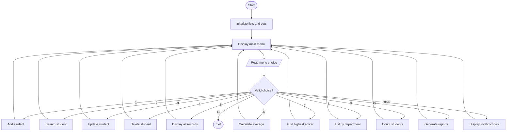
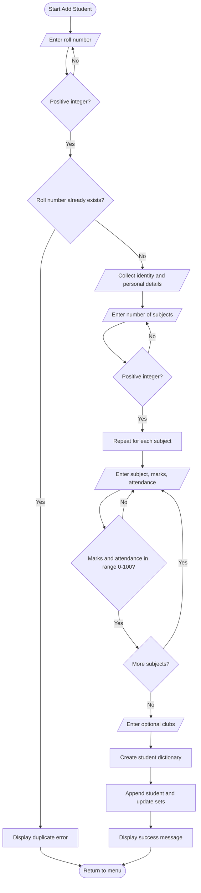
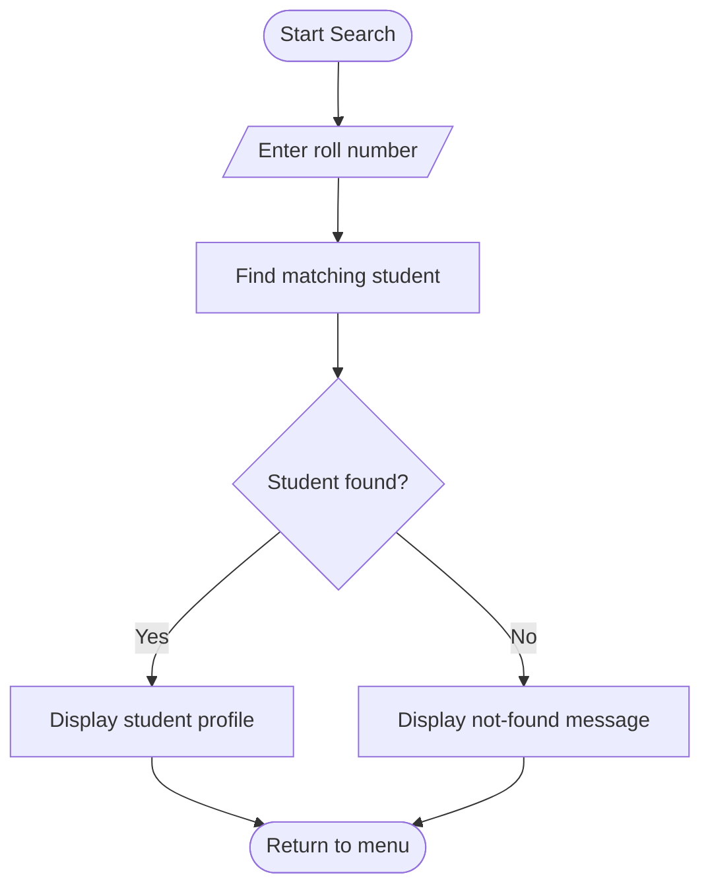
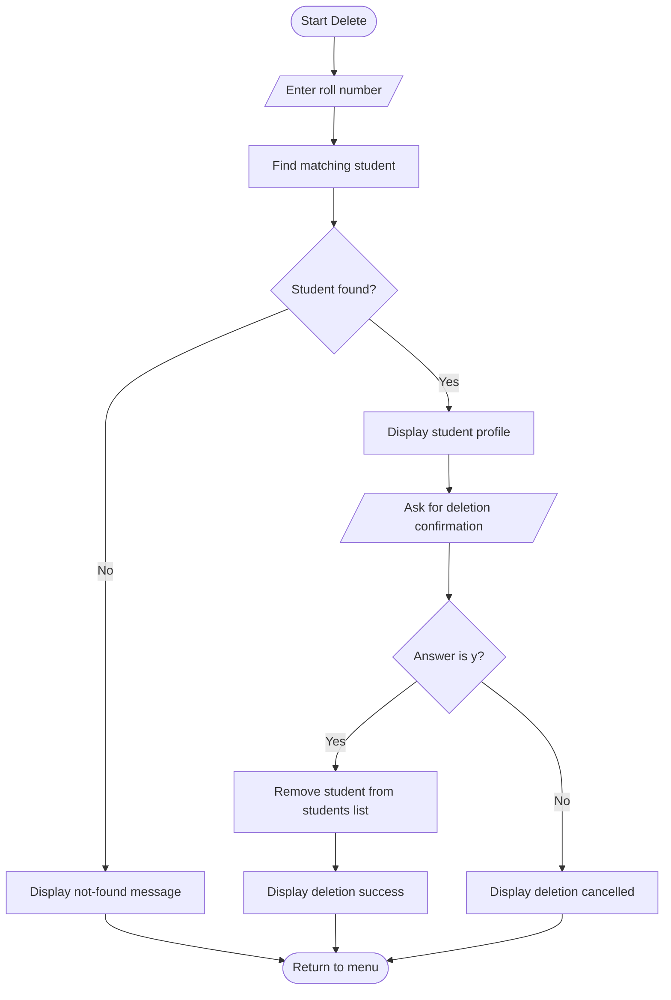
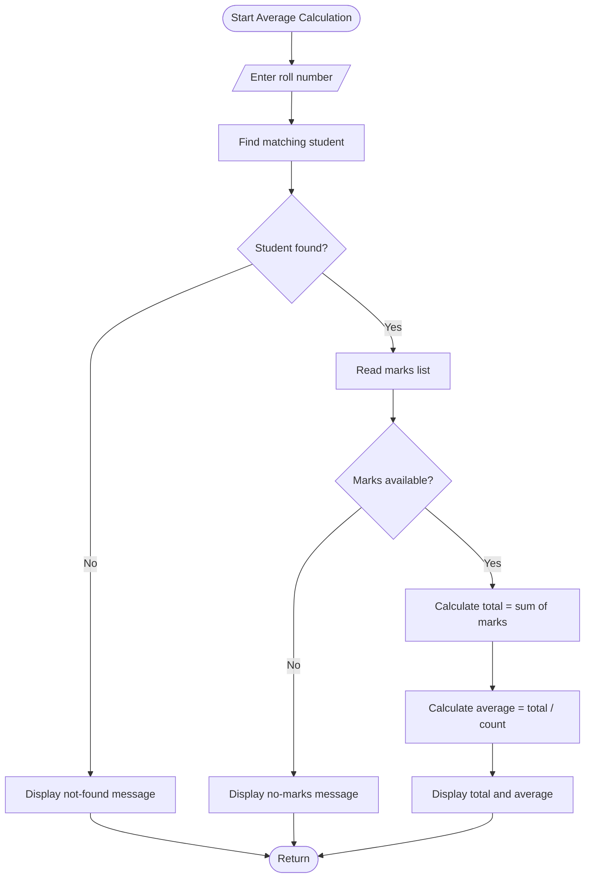
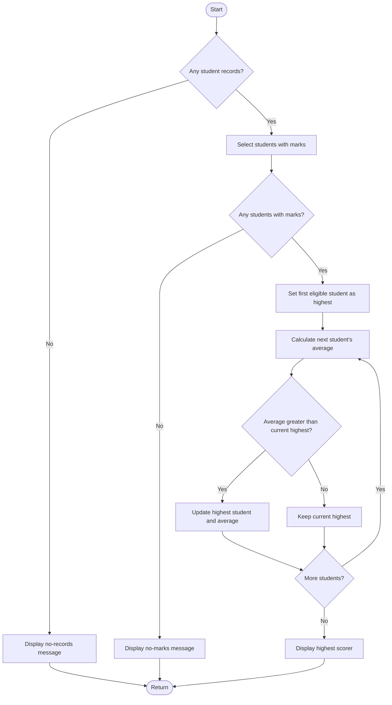

# Program Flowcharts

These flowcharts use Mermaid syntax. GitHub can render Mermaid diagrams in Markdown files.

## 1. Overall Program Flowchart

## 2. Add Student Flowchart

## 3. Search Student Flowchart

## 4. Delete Student Flowchart

## 5. Calculate Average Flowchart

## 6. Highest Scorer Flowchart

## 7. Notes

- These diagrams represent the logic of the supplied source code at a high level.
- The main program stores data in memory, so all records are lost when the process ends.
- If the source code changes, update the diagrams so they continue to match the implementation.
